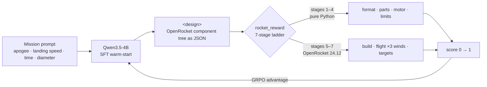

<div align="center">

# 🚀 RocketData

**A small language model that designs model rockets from a plain-English mission, and is graded by a real flight simulator.**

*"A rocket that reaches about 900 m on an H motor and lands under 6 m/s."* → a complete OpenRocket design that actually flies.


-FF6F00)


</div>

---

## Why

Rocket design is a search over hundreds of coupled choices: airframe, fins, motor, mass, recovery. Getting one wrong means the rocket is unstable, never leaves the rail, or lawn-darts into the ground. Language models are good at *sounding* like engineers. This project makes one *be* graded like one: every answer is built and flown in a 6-DOF simulator, and the model is trained on the result.

## How it works



1. **SFT warm-start.** Qwen3.5-4B is fine-tuned on designs reverse-engineered from real hobby rockets: each `.ork` file is simulated, its true apogee, landing speed and flight time become the prompt, and the design becomes the answer.
2. **RL with a verifiable reward.** GRPO samples 8 designs per prompt. Each one is scored by actually building and flying it, so the only way to score well is to design a rocket that works.

## The reward ladder

A design climbs seven checks in order. It is scored inside the band of the first check it fails, so getting further *always* scores more, and how close it came decides where in the band it lands.

| # | Stage | Score band | Passes when |
|:-:|---|:-:|---|
| 1 | **format** | 0.00 – 0.08 | the answer holds a readable design tree |
| 2 | **parts** | 0.10 – 0.18 | the eight parts every rocket needs are there |
| 3 | **motor** | 0.20 – 0.28 | every motor is a real, certified one |
| 4 | **limits** | 0.30 – 0.38 | sizes, counts and materials are physically sensible |
| 5 | **build** | 0.40 – 0.48 | OpenRocket builds it and the parts fit together |
| 6 | **flight** | 0.50 – 0.68 | it flies safely in three different winds |
| 7 | **targets** | 0.70 – 1.00 | it does what the prompt asked |

Built to resist reward hacking: launch conditions are fixed (the model cannot pick an easy wind or a long rail), fake motors are caught against a 1,500-motor certified table, a crash or hang in the simulator is scored as a design fault, and every rule in [`DESIGN.md`](rl/rocket_reward/DESIGN.md) is backed by a test.

## Results so far

Baseline: the SFT model (`RocketData/Qwen3.5-4B-rocketdata-v5`) on 48 held-out validation prompts, scored by the ladder.

| Furthest stage reached | Designs |
|---|:-:|
| format | 5 |
| parts | 6 |
| motor | **26** |
| limits | 3 |
| build | 6 |
| flight | 1 |
| targets | 1 |
| **Mean reward** | **0.249** |

Over half the designs stop at **motor**: the model invents motors that do not exist. That is exactly the kind of mistake a verifiable reward fixes, and it is the first thing RL is aimed at. RL results will be added here.

## Data

| | Count |
|---|:-:|
| Real rocket designs (`.ork`, `.rkt`, `.cdx1`) | 490+ |
| Certified motors with thrust curves | 1,528 |
| RL prompts, synthetic (train / val / test) | 2,000 / 50 / 50 |
| RL prompts, real kits (train / val / test) | 385 / 36 / 53 |

## Quick start

The reward runs anywhere with Python 3.10+ and Java 17. Training needs an NVIDIA GPU.

```bash
git clone https://github.com/Phorceon/rocketdata && cd rocketdata/rl

# score designs on any machine (no GPU)
python -m rocket_reward fetch-jar     # downloads OpenRocket 24.12, SHA-256 checked
python -m rocket_reward check         # flies a self-test rocket
python train_grpo.py --dry-run        # checks prompts + reward wiring

# train on a GPU box
bash setup.sh
python train_grpo.py --fast-inference --max-completion-len 12288 --wandb-project rocket-ai
```

Use the reward in your own trainer:

```python
from rocket_reward.adapters.trl import make_reward, make_diagnostics
from rocket_reward.sim import SimPool

with SimPool(4) as pool:                              # 4 OpenRocket workers
    reward = make_reward(simulator=pool, max_completion_tokens=12288)
    stages = make_diagnostics(reward)                 # per-stage pass rates, logged only
    GRPOTrainer(..., reward_funcs=[reward, *stages.values()]).train()
```

Full settings: [`rl/rocket_reward/adapters/README.md`](rl/rocket_reward/adapters/README.md).

## Repository layout

```
rl/                    everything needed for RL — copy this one folder to the GPU box
├── train_grpo.py      Unsloth + TRL GRPO training script
├── setup.sh           one-shot GPU box setup
└── rocket_reward/     the reward: parser, 7-stage ladder, OpenRocket helper, prompts, 2,300+ tests
raw_data/              source rockets, motor database, CAD
archive/               earlier SFT data pipelines and experiments
```

## Roadmap

- [x] Rocket + motor dataset from real hobby designs
- [x] Reverse-simulation SFT data and the SFT warm-start model
- [x] Physics-verified reward with a 7-stage ladder
- [x] GRPO training pipeline (Unsloth + TRL)
- [ ] Full GRPO run and before/after benchmark
- [ ] Interactive demo: type a mission, get a 3D model, flight plot and `.ork` file

## Built with

[OpenRocket](https://openrocket.info) · [Qwen](https://huggingface.co/Qwen) · [Unsloth](https://github.com/unslothai/unsloth) · [TRL](https://github.com/huggingface/trl) · [OpenRocket motor database](https://openrocket.github.io/motor-database/)
